# Grafana Cloud Synthetic Monitoring

**Platform:** Grafana Cloud Synthetic Monitoring  
**Private Probe:** PrivateProbeLab (EMEA)  


---

This project implemented a synthetic monitoring environment using Grafana Cloud. It combines Grafana-managed public probes with a self-hosted private probe deployed as a Docker container.

Four synthetic check types were configured to test different layers of service availability:

- HTTP uptime monitoring
- ICMP ping monitoring
- TCP connectivity monitoring
- DNS resolution monitoring

A Grafana dashboard was created with seven panels to consolidate probe availability and latency information. Grafana email alerting was also configured and tested.

The received notifications demonstrated both alert states: a **FIRING** notification when the private ping probe failed and a **RESOLVED** notification after the probe recovered.

The implementation provides a foundation for monitoring public endpoints and, through a private probe, services reachable from a controlled internal network.

---

# 1. Introduction and Project Objectives

Synthetic monitoring proactively tests services from selected probe locations. Instead of waiting for users to report a problem, scheduled checks attempt to reach an endpoint and record whether the test succeeds, how long it takes and whether configured validation conditions are met.

## Project objectives

1. Initialise Grafana Cloud Synthetic Monitoring.
2. Configure public probes and deploy an optional private probe.
3. Create HTTP, ICMP, TCP and DNS synthetic checks.
4. Configure validation rules, execution frequency and timeouts.
5. Analyse monitoring results using Grafana dashboards.
6. Configure email alerting and validate the firing and recovery lifecycle.
7. Document the implementation and retain screenshot evidence.

---

# 2. Task 1 — Initialise Synthetic Monitoring

Grafana Cloud was accessed and the **Testing & Synthetics → Synthetics** section was opened.

Synthetic Monitoring was initialised using the Grafana interface. The Synthetic Monitoring workspace provided access to the following sections:

- Overview
- Checks
- Probes
- Check Suggestions
- Configuration

This initialisation enabled the creation and management of synthetic checks and the viewing of probe execution results.

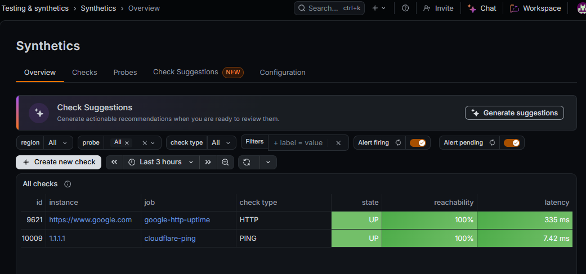

*Figure 1 — Grafana Cloud Synthetic Monitoring overview.*

---

# 3. Task 2 — Configure a Private Probe

## 3.1 Private probe registration

A private probe was registered in Grafana Cloud with the following configuration:

| Setting | Configured value |
|---|---|
| Probe name | PrivateProbeLab |
| Region | EMEA |
| Label | environment=lab |
| Latitude | 6.54421 |
| Longitude | 3.38421 |
| Probe ID | 182 |

The private probe demonstrates monitoring from a self-managed environment in addition to Grafana's public probe locations.


*Figure 2 — PrivateProbeLab registered and online.*

## 3.2 Docker agent deployment

The private Synthetic Monitoring agent was deployed using Docker Desktop integrated with Ubuntu 24.04 running under WSL2 on Windows 11.

Docker availability was checked and a test container was run successfully before deploying the agent.

The agent image was downloaded using:

```bash
docker pull grafana/synthetic-monitoring-agent:latest
```

The API token was entered interactively and exported as an environment variable. It was not embedded directly in the Docker command.

The API server used was:

```text
synthetic-monitoring-grpc-us-east-3.grafana.net:443
```

The container was started with:

```bash
docker run -d --name sm-agent --restart unless-stopped \
  -e SM_AGENT_API_TOKEN \
  -p 127.0.0.1:4050:4050 \
  grafana/synthetic-monitoring-agent:latest \
  --api-server-address="$API_SERVER" \
  --listen-address=0.0.0.0:4050
```

The container was confirmed running.

The local readiness endpoint was checked using:

```bash
curl -i http://127.0.0.1:4050/ready
```

It returned **HTTP 200 OK**.

Grafana subsequently displayed the private probe online with agent version `v0.70.0`.

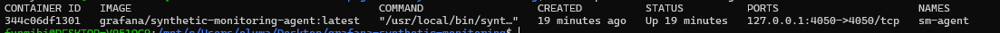

*Figure 3 — Synthetic Monitoring agent running in Docker.*

## 3.3 Private probe execution validation

The `PrivateProbeLab` probe was added to the `cloudflare-ping` check.

Its execution log confirmed:

- The target resolved to 1.1.1.1.
- Three ICMP packets were sent.
- Three ICMP packets were received.
- The check completed successfully.


*Figure 4 — Successful execution from the private probe.*

The private probe therefore demonstrated successful registration, agent connectivity and execution of an assigned synthetic check.

**Note:** The private probe was explicitly assigned to the ping check. It was not automatically assigned to every existing check.

---

# 4. Task 3 — Create Synthetic Checks

Four checks were configured to cover different network and application layers.

| Check name | Target | Check type | Purpose |
|---|---|---|---|
| google-http-uptime | https://www.google.com | HTTP GET | Tests HTTP endpoint availability. |
| cloudflare-ping | 1.1.1.1 | ICMP ping | Tests IP reachability and packet response. |
| cloudflare-https-tcp | 1.1.1.1:443 | TCP | Tests TCP connectivity to port 443. |
| google-dns-lookup | google.com | DNS A record | Tests DNS resolution for an IPv4 address. |

## 4.1 HTTP uptime check

The HTTP check was created with:

- Job name: `google-http-uptime`
- Target URL: `https://www.google.com`
- Request method: GET
- Expected successful status codes: 2xx

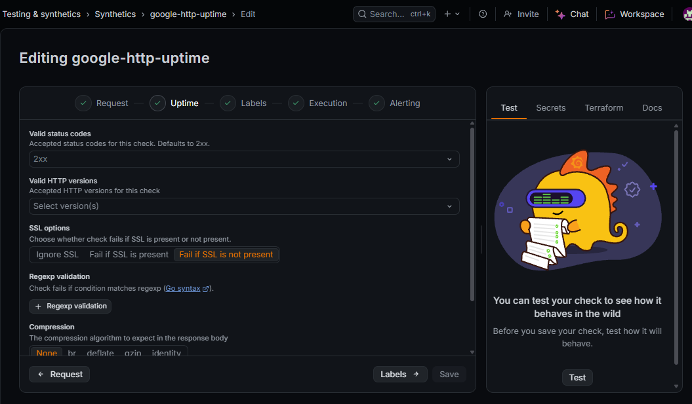

*Figure 5 — HTTP check configuration.*

The check dashboard was used to review uptime and probe data.

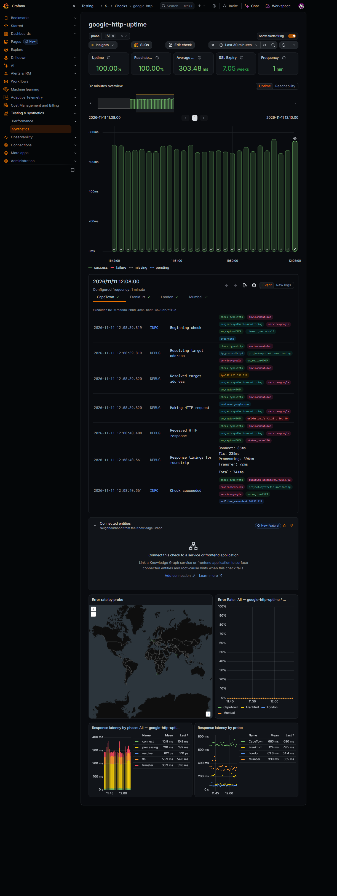

*Figure 6 — HTTP uptime check results.*

## 4.2 ICMP ping check

The `cloudflare-ping` check targeted `1.1.1.1`.

Its purpose was to test whether the destination responded to ICMP echo requests and to collect latency measurements.

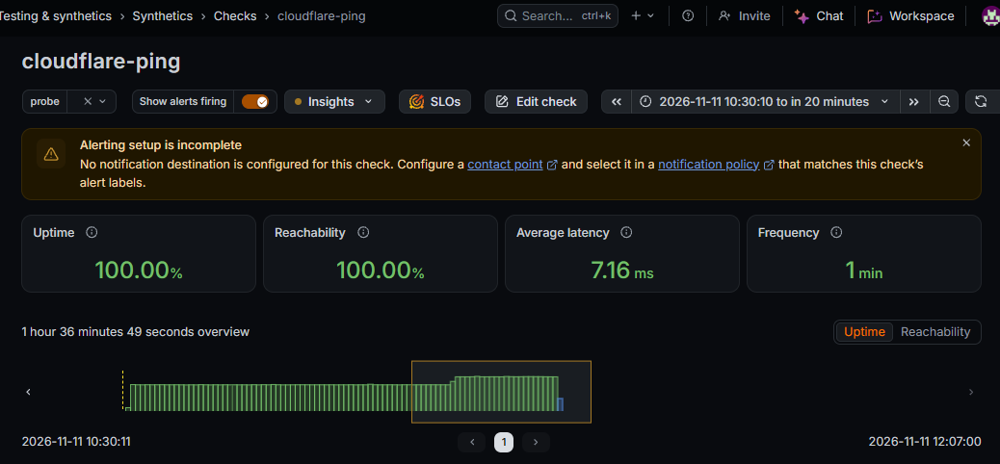

*Figure 7 — ICMP ping check results.*

## 4.3 TCP connectivity check

The `cloudflare-https-tcp` check targeted `1.1.1.1` on TCP port `443`.

The execution log showed that the probe successfully dialled the TCP endpoint.

A browser test initially returned a `400 Bad Request` message because a plain HTTP request was sent to an HTTPS port. This was a protocol mismatch in the browser request and did not mean that the TCP connection test had failed.

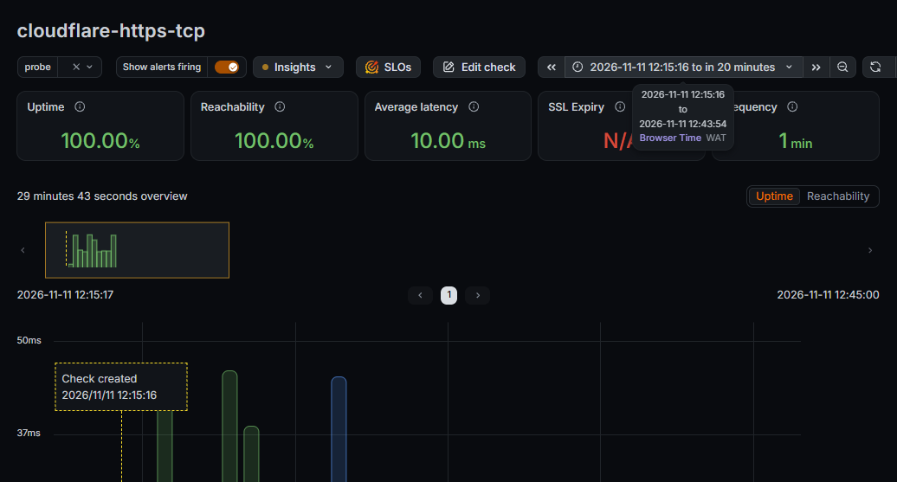

*Figure 8 — Successful TCP connectivity check.*

## 4.4 DNS lookup check

The `google-dns-lookup` check queried `google.com` for an IPv4 A record.

The detailed result view showed three answer records and regional response-time measurements.

Some high-level summary fields displayed N/A. The detailed DNS result view was used to assess the returned records and response data.

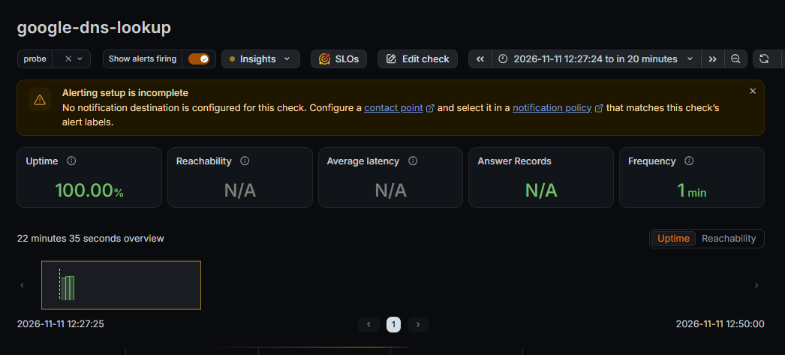

*Figure 9 — DNS lookup results.*

---

# 5. Task 4 — Define Validation Rules

Validation rules determine whether a check result should be treated as successful.

## 5.1 HTTP validation

For the HTTP check, the expected successful status-code range was configured as **2xx**.

This accepts successful HTTP responses, including `200 OK`.

## 5.2 Protocol-specific validation

The other checks used protocol-specific success criteria:

- **ICMP:** The ping check succeeds when the probe receives the expected ICMP responses.
- **TCP:** The check succeeds when a TCP connection to `1.1.1.1:443` can be established.
- **DNS:** The check performs the configured DNS lookup and records the returned answer data.

## 5.3 Response-body validation

A response-body regular-expression match was not configured as part of this implementation.

The assignment mentions body matching as an example of an additional validation rule. It should therefore be recorded as a possible enhancement rather than claimed as completed.

For stricter application validation, a body-content assertion can be added to the HTTP check and tested against expected response text.

---

# 6. Task 5 — Set Frequency and Timeouts

The checks were configured to run at one-minute intervals with a ten-second timeout.

| Parameter | Configuration | Reason |
|---|---|---|
| Execution frequency | 1 minute | Provides frequent visibility of availability and performance changes. |
| Timeout | 10 seconds | Limits how long an individual check waits before timing out. |

A one-minute interval provides relatively fine-grained monitoring and is useful for a demonstration environment where timely detection is important.

In production, check frequency should be selected according to:

- Service criticality.
- Required failure detection time.
- Probe coverage.
- Monitoring usage and cost limits.
- Expected traffic and user impact.

A less critical endpoint may not require a check every minute.

---

# 7. Task 6 — Analyse Data Using Dashboards

## 7.1 Dashboard overview

A dashboard titled **Grafana Synthetic Monitoring Dashboard** was created in the **Grafana Synthetic Monitoring** folder.

It contains seven panels covering availability and latency for the configured checks.

The dashboard provides a consolidated view of the synthetic monitoring environment rather than requiring the operator to open each check separately.

## 7.2 Dashboard panels

| Panel | Title | Visualisation | Purpose |
|---|---|---|---|
| 1 | Probe Availability by Location | State timeline | Shows ping check success or failure by probe. |
| 2 | Ping Latency by Location (ms) | Time series | Shows ping execution duration over time. |
| 3 | Average Ping Latency by Probe | Horizontal bar chart | Compares average ping latency by probe. |
| 4 | HTTP Uptime by Probe | State timeline | Shows HTTP check success or failure by probe. |
| 5 | TCP Connectivity by Probe | State timeline | Shows TCP check success or failure by probe. |
| 6 | DNS Lookup Availability by Probe | State timeline | Shows DNS check success or failure by probe. |
| 7 | HTTP Response Time by Probe (ms) | Time series | Shows HTTP check execution duration over time. |

## 7.3 PromQL queries

### Panel 1 — Probe Availability by Location

```promql
probe_success{
  job="cloudflare-ping",
  config_version="1794415734999004928"
}
```

### Panel 2 — Ping Latency by Location (ms)

```promql
probe_duration_seconds{
  job="cloudflare-ping",
  config_version="1794415734999004928"
} * 1000
```

### Panel 3 — Average Ping Latency by Probe

```promql
avg by (probe) (
  probe_duration_seconds{
    job="cloudflare-ping",
    config_version="1794415734999004928"
  }
) * 1000
```

### Panel 4 — HTTP Uptime by Probe

```promql
probe_success{job="google-http-uptime"}
```

### Panel 5 — TCP Connectivity by Probe

```promql
probe_success{job="cloudflare-https-tcp"}
```

### Panel 6 — DNS Lookup Availability by Probe

```promql
probe_success{job="google-dns-lookup"}
```

### Panel 7 — HTTP Response Time by Probe (ms)

```promql
probe_duration_seconds{job="google-http-uptime"} * 1000
```

The `probe_success` metric represents the success state of a check:

- `1` indicates success.
- `0` indicates failure.

The `probe_duration_seconds` metric is expressed in seconds. Multiplying it by `1000` converts the displayed value to milliseconds.

## 7.4 Dashboard evidence

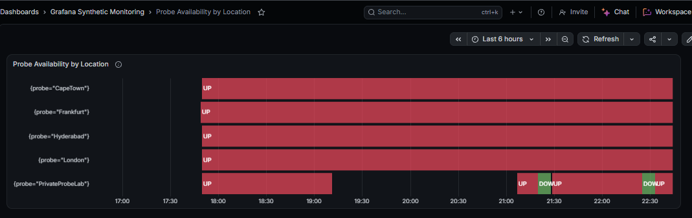

*Figure 10 — Probe availability by location.*

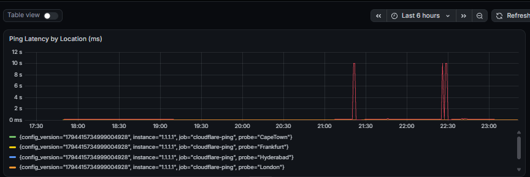

*Figure 11 — Ping latency time series by location. The panel was subsequently confirmed to be populating correctly.*

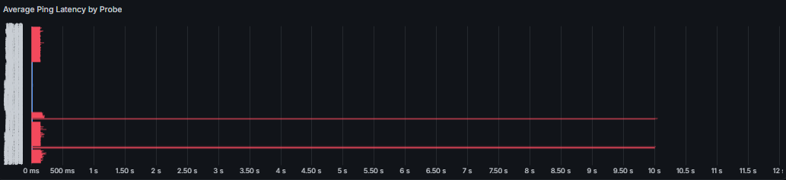

*Figure 12 — Average ping latency comparison by probe.*

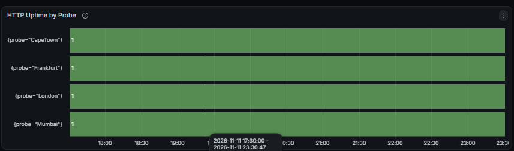

*Figure 13 — HTTP uptime by probe.*

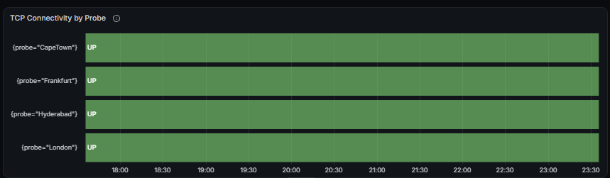

*Figure 14 — TCP connectivity by probe.*


*Figure 15 — DNS lookup availability by probe.*

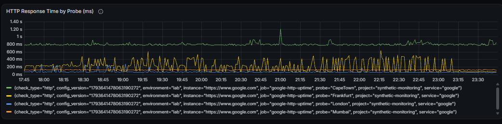

*Figure 16 — HTTP response time by probe.*

## 7.5 Uptime, reachability, latency and SSL observations

The check dashboards and Prometheus metrics provide several useful monitoring views.

### Uptime and success

The `probe_success` metric indicates whether an individual execution succeeded.

A success percentage over a selected time window can be derived from the proportion of successful executions.

### Reachability

ICMP results and TCP connection outcomes provide evidence of network-level reachability for their respective protocols.

### Latency

Ping and HTTP execution-duration panels provide a view of response-time behaviour over time and across probe locations.

### SSL certificate expiration

The TCP check used in this lab was configured as a TCP connection without TLS.

Its SSL expiry field was therefore not applicable.

SSL certificate expiry should be monitored using an HTTPS/TLS-enabled check or an appropriate certificate-expiry metric.

The TCP panel should not be interpreted as evidence that certificate-expiry monitoring was completed.

---

# 8. Task 7 — Configure Proactive Alerting

## 8.1 Email contact point

A Grafana email contact point was created and a test notification was sent successfully.

The configured contact point was selected as the notification destination for the alert rule.

## 8.2 Alert rule

A Grafana-managed alert rule named `cloudFarePingAlertFailure` was created using the `probe_success` metric for the `cloudflare-ping` job and the relevant check configuration version.

The intended alert logic is to trigger when the probe success value falls below `1`.

This represents a failed probe execution.

When the metric returns to `1`, the failure condition clears and the alert can resolve.

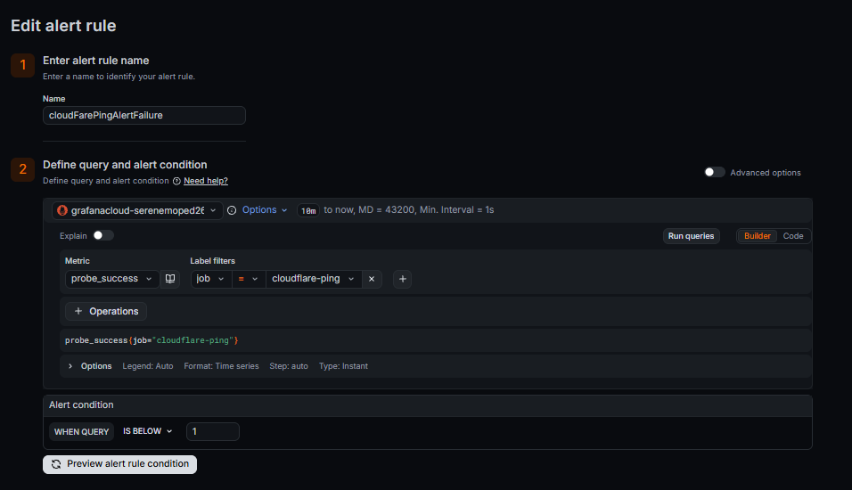

*Figure 17 — Grafana-managed alert rule configuration.*

## 8.3 Firing and resolved notification test

The alert lifecycle was validated using actual Grafana email notifications for `PrivateProbeLab`.

| Notification | Values shown in email | Meaning |
|---|---|---|
| FIRING | A=0, C=1 | The ping probe failed and the alert entered the firing state. |
| RESOLVED | A=1, C=0 | The ping probe recovered and the alert was resolved. |

The email notifications demonstrated that Grafana detected a failed probe, delivered a firing notification, detected recovery and delivered a resolved notification.


*Figure 18 — Grafana email notifications showing both firing and resolved states.*

---

# 9. Task 8 — Configuration as Code (Optional)

Configuration as Code using the Synthetic Monitoring API or Terraform was not implemented in this lab.

The checks and alert rule were configured through the Grafana Cloud user interface, while the private agent was deployed using a Docker command.

For a future extension, the Synthetic Monitoring API or a supported Terraform provider could be used to define checks, probe assignments and related resources in version-controlled configuration.

This would improve:

- Repeatability.
- Change review.
- Deployment consistency.
- Configuration recovery.
- Management across multiple environments.

No Terraform files or API automation scripts are included because they were not created as part of this implementation.

---

# 10. Probe Location and Frequency Justification

The public probes were selected to provide geographical diversity and demonstrate how the same check can be observed from multiple regions.

| Probe location | Region | Monitoring rationale |
|---|---|---|
| Cape Town | South Africa | Provides an African regional observation point. |
| Frankfurt | Germany | Provides a continental European observation point. |
| London | United Kingdom | Provides a UK and Western European observation point. |
| Hyderabad | India | Provides an Asian observation point. |
| PrivateProbeLab | EMEA private probe | Demonstrates monitoring from the self-managed lab environment. |

The public locations allow comparison of regional latency and availability.

The private probe demonstrates how monitoring can be extended to a controlled environment and can be used for services that are not publicly reachable, once the relevant private network connectivity and check assignments are configured.

The one-minute check interval was selected for timely feedback in the lab.

In a production deployment, locations should be selected based on the actual user population, hosting regions, network paths and business-critical services.

Check frequency should also reflect service criticality and acceptable monitoring overhead.

---

# 11. Results and Validation Summary

| Project area | Outcome | Validation |
|---|---|---|
| Synthetic Monitoring initialisation | Completed | Synthetic Monitoring interface became available. |
| HTTP check | Created and returning data | HTTP check dashboard and HTTP metrics queried. |
| ICMP ping check | Successful | Private probe execution recorded 3 packets sent and 3 received. |
| TCP check | Successful | TCP dial to 1.1.1.1:443 succeeded. |
| DNS check | Returning DNS data | Detailed results showed three answer records and regional response-time data. |
| Private probe | Online and executing | Docker container running, readiness endpoint returned HTTP 200, Grafana showed the probe online. |
| Dashboard | Seven panels created | All seven panels saved; ping latency panel later confirmed to be populating correctly. |
| Email alerting | Firing and resolved verified | Both notification states were received by email. |
| Configuration as Code | Not implemented | Recorded as an optional future enhancement. |

---

# 12. Lessons and Challenges

1. **HTTP and HTTPS protocol distinction:** Sending plain HTTP to an HTTPS port can return a 400 Bad Request response even when the TCP port is reachable. TCP connectivity and application-layer HTTP testing are separate checks.

2. **DNS summary interpretation:** Some high-level DNS summary fields displayed N/A, while the detailed result view showed answer records and response-time measurements. The detailed DNS output was important for interpreting the check.

3. **Private probe assignment:** Registering a private probe does not automatically assign it to every existing check. The probe must be selected for each check that should use it.

4. **Prometheus time series:** Query labels, selected time range and panel configuration affect the number of series displayed. The ping latency panel was reviewed and later confirmed to populate correctly.

5. **Alert lifecycle validation:** Testing both firing and resolved notifications verified failure detection and recovery, rather than only confirming that the alert rule had been saved.

6. **TLS monitoring scope:** A plain TCP check does not validate the TLS handshake or certificate expiry. A TLS-enabled check is required for that additional validation.

---

# 13. Operational Recommendations

- Keep the private probe host powered on and ensure Docker and the `sm-agent` container remain available.
- Protect the Synthetic Monitoring API token. Do not include it in screenshots, reports, source control or shared command histories.
- Confirm the email contact point remains valid and that alert rules remain enabled.
- Review availability and latency trends regularly, investigating sustained failures and recurring regional degradation.
- For production use, consider hosting the private probe on a stable, always-on Linux server rather than a personal workstation or WSL2 lab.
- Extend HTTP validation with response-body assertions where the service has a stable expected response.
- Add a TLS-enabled check if certificate expiry and TLS handshake validation are required.
- Consider Terraform or API-based configuration management when the environment needs repeatable deployments or multiple monitoring environments.

---

